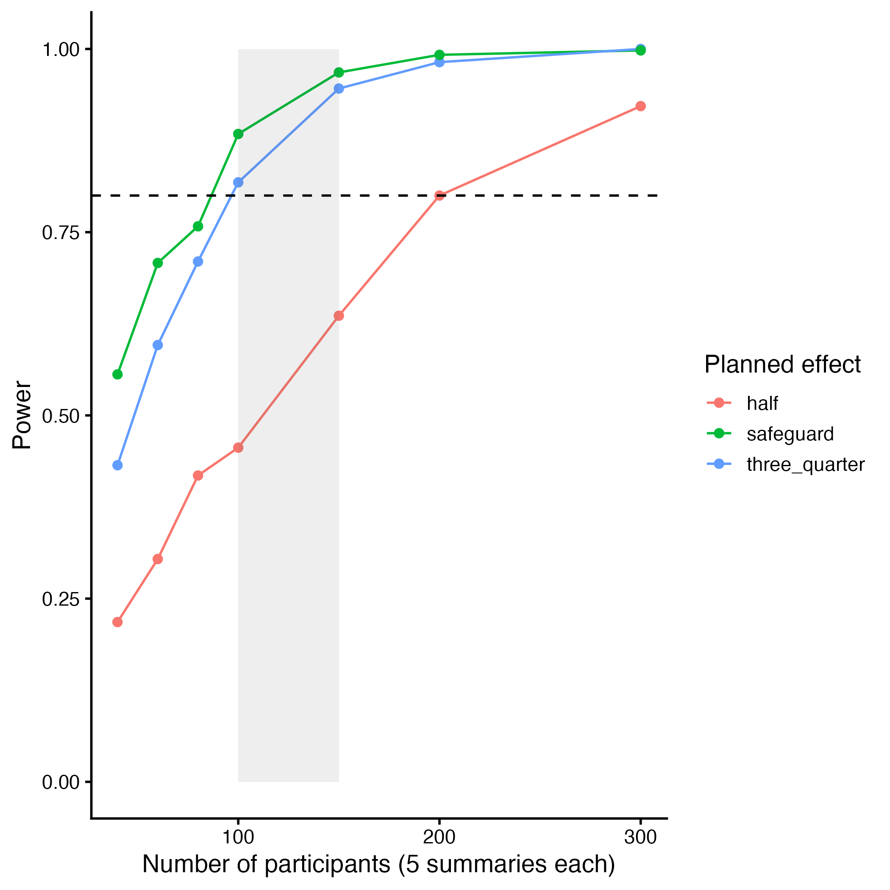

<!-- Replication reports should all use this template to standardize reporting across projects.  These reports will be public supplementary materials that accompany the summary report(s) of the aggregate results. -->

## Introduction

<!-- [No abstract is needed.]  Each replication project will have a straightforward, no frills report of the study and results.  These reports will be publicly available as supplementary material for the aggregate report(s) of the project as a whole.  Also, to maximize project integrity, the intro and methods will be written and critiqued in advance of data collection.  Introductions can be just 1-2 paragraphs clarifying the main idea of the original study, the target finding for replication, and any other essential information. You will likely contact the authors of the original study, so this should be professional and forward facing. It will NOT have a literature review -- that is in the original publication. You can write both the introduction and the methods in past tense. -->  

I am interested in understanding the psychological implications of generative AI, including how people perceive and respond to AI-generated information. I am particularly interested in whether using AI to make information more accessible changes not only people's understanding of that information but also their perceptions of its source, the author. Scientific information is one area where information may be difficult to grasp for non-experts because the language can be complex. I therefore chose to replicate Study 2 of Markowitz (2024), "From Complexity to Clarity: How AI Enhances Perceptions of Scientists and the Public's Understanding of Science". In Study 2, Markowitz experimentally tested whether reading simpler AI-generated scientific summaries rather than more complex human-written summaries of the same papers changed perceptions of scientists' trustworthiness, credibility, and intelligence. This work aligns with my broader interest in how generative AI may change people's psychological responses to information and to those who communicate it.

Study 1 consisted of gathering the PNAS significance statements, generating AI versions of the statements using GPT-4, and compared their linguistic features, including common words, analytic writing, and readability. In Study 2, the researcher selected five pairs of human-written significance statements and GPT-generated significance statements with the largest difference in common words. Participants read summaries from three of the five pairs, and for each selected pair they were randomly assigned to the GPT (simple) or PNAS (complex) version. Stated another way, each participant had the possibility of seeing three entirely AI-generated summaries or entirely human-written summaries from the way the original study was designed. After reading each summary, participants completed manipulation checks assessing its clarity, complexity, and how much of the summary they understood. Participants would then assess the 'scientist's' trustworthiness, credibility, and intelligence and indicate whether they believed the summary was written by a human or by AI. Participants were not told which summaries were AI-generated. 

Study 2 found small effects that went in different directions, where GPT summaries were rated as more credible and more trustworthy, but their authors were rated as less intelligent and the three-item perceptions index (trustworthiness, credibility, and intelligence) was only modestly higher for GPT summaries. Following feedback from the PSYC 201A teaching team, my single confirmatory test is the effect of summary version (GPT vs. PNAS) on ratings of the scientist's *trustworthiness*, using the original linear mixed model. I chose trustworthiness for a few reasons. First, it was the largest author-perception effect in Study 2. Second, it is the outcome most closely tied to the paper's motivating claim that simpler AI writing can counter declining trust in scientists. Third, it did not replicate in Study 3, which used 20 stimulus pairs, and the author suggests that the multitude and difference in the stimuli of Study 3 may explain this difference. My replication uses the same five pairs as Study 2, where I ask a narrower question of does the Study 2 trust effect replicate with the same stimuli in a new sample? I am not using the three-item perceptions index as the confirmatory outcome because it averages items that have effects in different directions (GPT 'authors' were rated more trustworthy and credible but less intelligent). 

To address additional comments from the teaching team, I aim to randomly assign the AI-generated or human written statements in balancing these versions within participants so that no participant receives either all human-written statements or all AI-generated statements. As for concerns about the time frame for completing this study, I plan to add two more summaries (five per person, the same number as Study 3) and an AI questionnaire I have developed with close-ended and open-ended questions about participants' own AI use and experience in navigating AI at UCSD. In a pilot (pilot B) with seven SONA participants, most finished in 11 minutes to 22 minutes.

To analyze this data, I will use linear mixed-effects models because each participant provides multiple observations and each stimulus is seen by many participants. Further following Markowitz (2024), the confirmatory model includes summary version (GPT/simple vs PNAS/complex) as the fixed effect and random intercepts for both participant and stimulus. Because there are only five stimuli, the stimulus random intercept is estimated from very few levels and may be estimated at or near zero (a singular fit). Also to note, with five stimuli, any conclusion applies to these five summary pairs rather than to scientific summaries in general.

One anticipated challenge will be to gather enough participant data in the time frame of a few weeks, depending on the sample size from the power analysis. Another challenge is the difference in samples. The original study drew from a sample of U.S. adults on Prolific. For this replication project, SONA participants consist of undergraduate students, who may be very familiar with AI tools and AI-generated outputs. Because of this familiarization with AI, SONA participants' assessments may lead to variations in their ratings and human/AI judgments such that they may use AI tools much more and may be better at spotting AI-stylistic outputs. To measure this, I aim to add questions about students' experiences in navigating AI in their classes and with their peers, which I will use in exploratory analyses. Another challenge is that generative AI tools have increasingly improved in their capabilities from 2024 to 2026. This means that the 2024 outputs might be more recognizable due to the nature of AI tool outputs at the time. Now, AI generated outputs may differ, where people may find it more difficult to distinguish AI-generated text from human-written text, because current models produce writing that is more varied and natural-sounding than the 2024 outputs. To stick to the original study, I plan to use Markowitz’s original GPT-generated summaries as stimuli rather than generating new ones.

For my learning goals, I want to learn how to concretely run a power analysis. I am also interested in simulating the results of this study, especially since I need to do so anyways to determine the effect sizes since the original paper did not include them. I hope to develop a deeper understanding of coding in R. Regarding feasibility, I think if I stick with the original AI-generated summary statements, it will be feasible to replicate this experiment, except with more summary statements and an added end-of-study AI questionnaire.

Link to repo: <https://github.com/sisegall/markowitz2024>

Linked pathway to the original paper: <https://github.com/sisegall/markowitz2024/blob/main/original_paper/Markowitz_2024_PNASNexus_AI_science_summaries.pdf> 

Original data and materials (OSF): <https://osf.io/64am3/> · Study 2 data: <https://osf.io/download/xjnfg/> · Stimuli: <https://osf.io/download/fnh74/> · Preregistration (Study 2): <https://aspredicted.org/C3K_T31>


## Methods

### Power Analysis

<!--Original effect size, power analysis for samples to achieve 80%, 90%, 95% power to detect that effect size.  Considerations of feasibility for selecting planned sample size.-->

{#fig-power}

The original study (N = 274 participants, 3 summaries each) found that GPT summaries were rated as more trustworthy than PNAS summaries by 0.28 points on a 7-point scale (linear mixed model with random intercepts for participant and stimulus, t = 4.63). Because published effects tend to be inflated, I planned for three smaller effects: safeguard power, the lower end of a 60% confidence interval on the original effect (0.23 points); 75% of the original effect (0.21 points); and half of the original effect (0.14 points). I simulated my own design, in which each participant rates 5 summaries, using the participant and random variability from the original data. The 2.5× rule (Simonsohn, 2015) would call for 685 participants, which is more than I can recruit this quarter, so I will aim for at least 100 participants. I expect no more than 150 participants (see Planned Sample section below for the stopping rule). With 100 participants, my simulations give about 83% power for the safeguard effect, 76% for 75% of the original effect, and 38% for half of it. With 150 participants, these rise to about 99%, 93%, and 62%, respectively. This means 100 participants can reliably detect an effect of about 0.23 points or larger. A non-significant result would tell me the effect is likely smaller than this, but could not rule out a smaller effect, such as half the original (0.14 points).

### Planned Sample

<!--Planned sample size and/or termination rule, sampling frame, known demographics if any, preselection rules if any.-->

As determined via the power analysis, I will stop collecting data when at least 100 participants complete the study, or at the end of the class deadline for the data-collection window, whichever comes first. In practice, I will close the SONA sign-up slots once 100 participants have completed the study. Anyone who has already signed up and completes the study before it closes is included. Pilot data are not included in the sample. If the class deadline for the data collection window closes first, I will report the achieved sample size and the power it gives under the simulation model.

Participants will be UCSD undergraduates recruited through SONA who are 18 or older and they will receive course credit. Sign-ups on SONA are restricted to native English speakers. I will collect age, gender, race/ethnicity, and political ideology, as the original Markowitz (2024) study did, as well as year in school, native language, major, and exploratory questions related to AI use. I expect the sample to be younger and use AI tools more than the original Prolific sample.

### Materials

<!--All materials - can quote directly from original article - just put the text in quotations and note that this was followed precisely.  Or, quote directly and just point out exceptions to what was described in the original article.-->

**Stimuli.** The stimuli are the five GPT/PNAS significance-statement pairs from Study 2, which the original paper describes as "Five pairs of stimuli from study 1b were selected for the experiment, having had the greatest difference in common words scores between the PNAS and GPT texts." I will use the texts verbatim from the original OSF stimulus file (osf.io/64am3). The papers are PNAS 1507704112 (adenosine/dopamine receptors), 1809962115 (subduction zone temperatures), 1902227116 (heparan sulfate in sepsis), 2004900117 (titin oxidation in heart muscle), and 2220518120 (DNA in a bacteriophage capsid).

**Measures.** Every measure from Study 2 is used with the original wording and 7-point scales:

- *Manipulation checks:* "How clear was the writing in the summary you just read?" and "How complex was the writing in the summary you just read?" (1 = not at all, 7 = extremely); "How much of this writing did you understand?" (1 = not at all, 7 = an enormous amount).
- *Author perceptions:* "How intelligent is the scientist who wrote this summary?", "How credible is the scientist who wrote this summary?", and **"How trustworthy is the scientist who wrote this summary?"** (the confirmatory outcome) (1 = not at all, 7 = extremely).
- *Author identity:* "This summary was written by a human." and "This summary was written by Artificial Intelligence." (1 = strongly disagree, 7 = strongly agree).
- *Demographics:* age, gender, race/ethnicity, and political ideology (1 = extremely liberal, 7 = extremely conservative), as in the original. I also ask year in school, whether English is their native language, and their declared or intended major.

**Added end-of-study AI questionnaire (new, exploratory).** After all five summaries and their Study 2 ratings, a separate instruction screen tells participants they will now answer questions about their attitudes and experiences with generative AI tools. The questions are adapted for undergraduates from a survey of high school students and teachers about AI in education from a previous project of mine. In order, participants answer:

- *AI use:* which AI tools they have used for coursework and outside coursework (select all that apply); how often they use AI for coursework (More than once a day to Never); the ways they have used AI in coursework and outside coursework (select all that apply); an open-ended description of a specific example of using AI for coursework (required); and the percentage of the time they copy and paste AI output without changes (0-100% slider).
- *Norms:* which uses of AI are acceptable in college courses (select all that apply), and the percentage of classmates they think still use AI on assignments where it is not allowed (slider).
- *Attitudes:* twelve statements rated from 1 = strongly disagree to 7 = strongly agree, shown one per screen in random order (e.g., "Using AI tools generally has a negative impact on critical thinking skills" and "AI tools have negatively impacted trust between instructors and students"). One of the twelve asks about AI detection: "I am confident in my ability to detect AI-generated text." The attention check is mixed into this block at a random position: "To show that you are reading carefully, please select 'Strongly disagree' for this question."
- *Conversations about AI:* the tone of conversations about AI with other students and the tone of instructors' messages about AI (Very supportive to Very opposed, or do not discuss), and the percentage of their courses in which an instructor or TA has mentioned AI (slider).
- *Concerns:* concern about 13 AI-related topics (e.g., misinformation, bias, privacy, academic integrity, the future of work, environmental costs), one topic per screen in random order, each rated on a slider from 0 = Not at all concerned to 100 = Very concerned.
- *Experiences:* benefits and challenges they have personally experienced (select all that apply), and two open-ended questions about AI disasters in their courses at UCSD and anything else they would like to share.

**AI and bot checks (new, robustness check only)** The first open-ended question contains a sentence in white text that participants cannot see, telling any AI model completing the survey to include the word "periwinkle" in its answer. For each open-ended answer, the experiment also records the number of keystrokes, pastes, and characters pasted, the answer's length, and how often the participant left the browser tab. These are used only to exclude participants in the robustness check (see Ananlysis Plan).


### Procedure	

<!--Can quote directly from original article - just put the text in quotations and note that this was followed precisely.  Or, quote directly and just point out exceptions to what was described in the original article..-->

**Instructions.** Following Study 2, participants are first told: "You will read scientific summaries and make judgments about the authors of these texts." Above each summary they are told, "Please read the summary of a scientific paper below, and then answer the questions about it, the summary," and that "We are not expecting you to be an expert in the topic discussed below. Instead, make your judgments based on how the summary is written." The order of the three measure blocks is randomized for each summary, and items within each block are randomized as well, as in the original.

**Assignments and randomization.** Every participant reads one summary for each of the five papers, in a random order. Version is assigned within participants via experiment code in jsPsych when the study loads. Two of five summaries are shown in the AI version, two in the human version, and the version of the fifth summary is randomized. The five version labels are then shuffled across the five papers. Each participant therefore sees three summaries of one version and two of the other, so they are not seeing five summaries of the same version. 

**Presentation.** Each summary shows up on its own screen. Then, each of the eight rating questions has its own screen, with the summary still present right above. The time spent on each screen is recorded.

**Order of the study.** Every participant follows this order: (1) consent and instructions; (2) for each of the five summaries, read the summary and then rate it on the eight Study 2 items (manipulation checks, author perceptions, and author identity; I will analyze trustworthiness as the confirmatory outcome); (3) the AI questionnaire, introduced by its own instruction screen; (4) demographics; (5) debrief, after which participants are returned to SONA to receive credit. Every question requires an answer before the participant can continue. Participants can still stop at any time by closing the study, so anyone who completes the study has no missing responses.

### Analysis Plan

<!--Can also quote directly, though it is less often spelled out effectively for an analysis strategy section.  The key is to report an analysis strategy that is as close to the original - data cleaning rules, data exclusion rules, covariates, etc. - as possible.-->  

<!--**Clarify key analysis of interest here**  You can also pre-specify additional analyses you plan to do.-->

**Confirmatory analysis.** This is a single key test. The outcome is the trustworthiness rating (scale from 1-7). The predictor is summary version. Following the original study analysis, I will fit a linear mixed model with random intercepts for participant and stimulus, using `lme4` defaults:

$$\text{Trust}_{ij} = \beta_0 + \beta_1\, \text{Version}_{ij} + u_{0i} + w_{0j} + \varepsilon_{ij}$$
- $i$ = indexes participants
- $j$ = indexes the five stimulus pairs
- $\text{Version}_{ij}$ = 1 is GPT, 0 is PNAS
- $\beta_1$ = GPT - PNAS for difference in mean trust
- $u_{0i}$ & $w_{0j}$ = random intercepts for participant and stimulus
- $\varepsilon_{ij}$ = residual

lmer(response ~ version + (1 | subject_id) + (1 | stimulus_id), data = trust)

I will test $\beta_1$ two-tailed at alpha = .05, using the degrees of freedom from `lmerTest`, as in the original analysis, which cites `lme4` and `lmerTest`. I will report $\hat\beta_1$ with its standard error, df, *t*, *p*, and 95% confidence interval (`confint()`), along with the estimated marginal means for each version (`emmeans`), the random-effect variances, and marginal and conditional. 

R^2 (`MuMIn`, the package used in the original paper).

**Variable coding and transformations.** Version is a factor with PNAS as the reference level (GPT = 1, PNAS = 0) so that $\hat\beta_1$ is the GPT minus PNAS difference in points on the 1-7 scale and has the same sign as in the original paper. Trust ratings are analyzed on the 1-7 scale. No other variables are transformed, centered, standardized, or recoded for the confirmatory model. 

**Singular fit.** With only five stimuli, the stimulus variance may be estimated at or near zero, which lme4 reports as a singular fit. If that happens, I will refit the model with stimulus as a fixed effect (four dummy codes) instead of a random intercept, keep the participant random intercept, and use that model for the confirmatory test. I will report both models. Either way, my conclusions apply to these five summary pairs, not to scientific summaries in general. 

**Replication criterion.** The study replicates if $\hat\beta_1 > 0$ and *p* < .05, meaning GPT summaries are rated as more trustworthy than PNAS summaries. I will also report whether the original estimate (about 0.28) falls inside the 95% CI of the replication estimate. Because this is a single confirmatory test, no correction for multiple comparisons is needed.

**Data inclusion and exclusion rules.** The original preregistration states, "No outliers nor exclusions are anticipated," and the paper reports no exclusions. To match this, the confirmatory analysis includes all participants who completed the study (reached the debrief screen) with no exclusions, which matches the original. Only complete data files are analyzed, DataPipe's partial backup from people who did not finish are not included. As a robustness check, I will rerun the same confirmatory model on a restricted sample that excludes participants who: (a) failed the attention check (any answer other than "Strongly Disagree"); (b) spent under 10 seconds on the reading screen for 3 or more of the 5 summaries; (c) show signs that ann AI completed the survey on any of the three open-ended questions; or took under 5 minutes or over 60 minutes to complete the study. If the two analyses disagree, I will report both and treat the confirmatory analysis with no exclusions as the primary analysis. 

**Secondary analyses.** I will fit the same model to each of the other seven ratings (ratings include clarity, complexity, ability to understand, intelligence, credibility, written by human, written by AI) and report the estimates beside the original values from the original study. 

**Exploratory analyses.** Responses to the AI questionnaire are used only in exploratory analyses, for example whether AI-use frequency or attitudes toward AI relate to the effect of summary version on trust or on the human/AI authorship ratings. These analyses are not part of the confirmatory test.


### Differences from Original Study

<!--Explicitly describe known differences in sample, setting, procedure, and analysis plan from original study.  The goal, of course, is to minimize those differences, but differences will inevitably occur.  Also, note whether such differences are anticipated to make a difference based on claims in the original article or subsequent published research on the conditions for obtaining the effect.-->

**Sample:** The replication will run with UCSD undergraduates on SONA instead of U.S. adults on Prolific. Students likely use AI tools more and are perhaps more prone to recognize AI writing, which could weaken the GPT advantage, change the human/AI judgments, or both. The paper does not identify sample characteristics as moderators. AI use is measured so this can be examined.

**Setting:** Online in both cases. SONA participants receive course credit instead of payment.

**Number of summaries and assignment:** Participants see five summaries instead of three, and versions are balanced within participants instead of assigned independently for each pair. Every participant contributes both versions, which should increase precision. The extra trials could add fatigue, but the measures are short and Study 3 also used five summaries.

**Added end-of-study measures:** The AI questionnaire and the added demographic questions come after all ratings, so they cannot affect the confirmatory outcome. IN the pilot, most participants finished in about 11 to 22 minutes. The attention check and the AI and bot checks are new, and are only used in the robustness check.

**Analysis:** The confirmatory model matches the original model and like the original, the confirmatory analysis has no exclusions. The original analyzed several outcomes, while for this project trustworthiness is the single confirmatory outcome. 

**Time since original:** Participants in 2026 may judge 2024 GPT-4 text differently from participants in 2024. I am keeping the original stimuli so that I can run a direct replication of Study 2.


### Methods Addendum (Post Data Collection)

You can comment this section out prior to final report with data collection.

#### Actual Sample
  Sample size, demographics, data exclusions based on rules spelled out in analysis plan

#### Differences from pre-data collection methods plan
  Any differences from what was described as the original plan, or “none”.


## Results


### Data preparation

Data preparation following the analysis plan.
	
```{r}
#| eval: false
# Planned analysis code, written before data collection.
# eval is off so the report renders before the main data exist. Set eval to true afterwards.

#### Import data
# DataPipe saves one CSV per participant. The raw data sit outside the repo.
files <- list.files(here("..", "replication of Markowitz 2024", "main"),
                    pattern = "\\.csv$", full.names = TRUE)
all_data <- read_csv(files, show_col_types = FALSE)

#### Keep everyone who completed the study (reached the debrief screen)
finished_ids <- all_data %>%
  filter(measure == "debrief") %>%
  pull(subject_id)

complete_data <- all_data %>%
  filter(subject_id %in% finished_ids)

#### Prepare data for analysis
trust <- complete_data %>%
  filter(measure == "trustworthy") %>%
  mutate(response = as.numeric(response)) %>%
  mutate(version = factor(version, levels = c("pnas", "gpt"))) %>%
  select(subject_id, stimulus_id, version, response)

#### Data exclusion / filtering (robustness check only)
# (a) attention check
passed_ids <- complete_data %>%
  filter(measure == "attention_check", response == "1") %>%
  pull(subject_id)

# (b) under 10 seconds on 3 or more reading screens
reading_ok_ids <- complete_data %>%
  filter(measure == "read") %>%
  mutate(rt = as.numeric(rt)) %>%
  group_by(subject_id) %>%
  summarise(n_fast = sum(rt < 10000)) %>%
  filter(n_fast < 3) %>%
  pull(subject_id)

# (c) signs of AI on the open-ended questions
flagged_ids <- complete_data %>%
  filter(measure %in% c("ai_example_coursework", "ai_disasters", "ai_elaborate")) %>%
  filter(honeypot_triggered == TRUE | paste_count > 0 | keystrokes < response_length / 2) %>%
  pull(subject_id)

# (d) total time between 5 and 60 minutes
time_ok_ids <- complete_data %>%
  filter(measure == "debrief") %>%
  mutate(minutes = time_elapsed / 60000) %>%
  filter(minutes >= 5, minutes <= 60) %>%
  pull(subject_id)

trust_robust <- trust %>%
  filter(subject_id %in% passed_ids) %>%
  filter(subject_id %in% reading_ok_ids) %>%
  filter(!(subject_id %in% flagged_ids)) %>%
  filter(subject_id %in% time_ok_ids)
```

```{r}
#| eval: false
#### Confirmatory model
trust_model <- lmer(response ~ version + (1 | subject_id) + (1 | stimulus_id),
                    data = trust)
summary(trust_model)

# singular fit rule: if TRUE, the fixed-stimulus model below is the confirmatory test
isSingular(trust_model)
trust_model_fixed <- lmer(response ~ version + stimulus_id + (1 | subject_id),
                          data = trust)
summary(trust_model_fixed)

# numbers to report (use trust_model_fixed instead if the fit was singular)
confint(trust_model, parm = "versiongpt")
emmeans(trust_model, ~ version)
r.squaredGLMM(trust_model)

#### Robustness check: same model on the restricted sample
trust_robust_model <- lmer(response ~ version + (1 | subject_id) + (1 | stimulus_id),
                           data = trust_robust)
summary(trust_robust_model)
isSingular(trust_robust_model)
trust_robust_model_fixed <- lmer(response ~ version + stimulus_id + (1 | subject_id),
                                 data = trust_robust)
summary(trust_robust_model_fixed)
```


### Confirmatory analysis

The analyses as specified in the analysis plan.  

*Side-by-side graph with original graph is ideal here*

### Exploratory analyses

Any follow-up analyses desired (not required).  

## Discussion

### Summary of Replication Attempt

Open the discussion section with a paragraph summarizing the primary result from the confirmatory analysis and the assessment of whether it replicated, partially replicated, or failed to replicate the original result.  

### Commentary

Add open-ended commentary (if any) reflecting (a) insights from follow-up exploratory analysis, (b) assessment of the meaning of the replication (or not) - e.g., for a failure to replicate, are the differences between original and present study ones that definitely, plausibly, or are unlikely to have been moderators of the result, and (c) discussion of any objections or challenges raised by the current and original authors about the replication attempt.  None of these need to be long.
